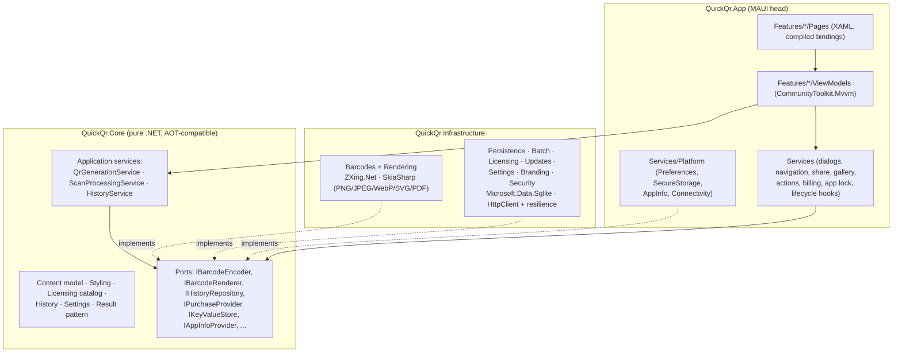

# QuickQr architecture

QuickQr is a .NET 11 MAUI app for Android, iOS, macOS (Mac Catalyst) and Windows. It uses a layered **clean architecture**: the domain sits at the center and knows nothing about MAUI, SkiaSharp, ZXing, SQLite or HTTP. Those technologies plug in at the edges as adapters.



**Dependency rule:** arrows point inward only. `Core` references nothing. `Infrastructure` references `Core`. `App` references both and is the composition root.

## Projects

| Project | TFM | Responsibility | Rules |
|---|---|---|---|
| `src/QuickQr.Core` | `net11.0` | Domain model (19 content types, styles, licensing tiers), application services, ports | No I/O and no third-party packages. `TreatWarningsAsErrors`, `IsAotCompatible`, JSON via source generation only |
| `src/QuickQr.Infrastructure` | `net11.0` | Adapters: ZXing.Net encoding and decoding, SkiaSharp rendering, SQLite history with FTS5, CSV/ZIP batch, GitHub updates, entitlements, settings, brand kits | No MAUI dependency. Platform facts arrive through `Core.Platform` ports |
| `src/QuickQr.App` | `net11.0-android/ios/maccatalyst/windows` | MAUI UI: feature modules, app services, platform code | MVVM, compiled bindings, no business logic in code-behind |
| `tests/QuickQr.Core.Tests` | `net11.0` | Encoders, parsers, safety analyzer, crypto, application services | xUnit v3 on Microsoft.Testing.Platform |
| `tests/QuickQr.Codecs.Tests` | `net11.0` | Encode → styled render → decode round-trips, SVG/PDF/print sheets | Runs real SkiaSharp natives |
| `tests/QuickQr.Infrastructure.Tests` | `net11.0` | SQLite repository, exporters, batch, entitlements, update checks (fake HTTP) | Uses temp databases and `FakeTimeProvider` |

## Key flows

### Generate
1. `GenerateViewModel` builds a typed `QrContent` (for example `WifiContent`) from the active form.
2. `IQrGenerationService.GenerateAsync(request, GenerationMode.Preview)` runs on each debounced edit:
   - `IContentEncoder` turns the content into a payload that follows the standard for its type, or returns a validation `Error`.
   - `IBarcodeEncoder` (ZXing) turns the payload into a `BarcodeMatrix` with one cell per module.
   - `IBarcodeRenderer` (Skia) applies the `QrStyle` (shapes, eyes, gradient, logo, frame) and produces the image.
3. Save, Share and Export call the service with `GenerationMode.Export`. Export enforces entitlements: `GetLockedFeatures` → `IPremiumGate` → paywall. It also records history (best effort) and the view model runs a decode check on the result.

### Scan
1. The camera (BarcodeScanning.Native.Maui: ML Kit, Apple Vision or zxing-cpp) or `IBarcodeImageDecoder` produces raw text.
2. `IScanProcessingService.ProcessAsync` produces a `ScanOutcome`:
   - `IContentParser` classifies the payload (it never fails; unknown input becomes `TextContent`).
   - `IContentSummarizer` and `IContentActionProvider` supply the title, icon and suggested actions.
   - `IUrlSafetyAnalyzer` runs offline anti-phishing heuristics on any link target.
   - `IHistoryService` records the scan.
3. The result panel shows the safety report, and `IContentActionExecutor` carries out the chosen action (open, join Wi-Fi, add contact, calendar, pay, decrypt, ...).

## Cross-cutting decisions

| Concern | Decision |
|---|---|
| Errors | The `Result`/`Result<T>` pattern with stable `ErrorCodes` for expected failures (validation, a locked feature, payload too large). Exceptions only for bugs. `ViewModelBase.RunBusyAsync` logs failures and shows an alert. |
| Premium | `FeatureCatalog` (Core) is the single source of truth: feature → tier → availability. `IEntitlementService` answers `HasFeature`. Preview is never gated, so users can try before they buy; export is gated. The paywall goes through `IPremiumGate`. |
| Billing | `IPurchaseProvider` port. `StorePurchaseProvider` (Plugin.InAppBilling, Release builds) or `SimulatedPurchaseProvider` (Debug/CI). Entitlements are cached in secure storage with a 7-day offline grace period. |
| Persistence | Microsoft.Data.Sqlite with hand-written parameterised SQL and `PRAGMA user_version` migrations. It is trim-safe because it uses no reflection ORM. FTS5 powers history search. |
| HTTP | `IHttpClientFactory` typed clients with `AddStandardResilienceHandler` (retry, circuit breaker, timeouts). |
| Serialization | System.Text.Json source generators only (`CoreJsonContext` plus infrastructure contexts), which keeps trimming and AOT safe. |
| UI | XAML source generator (the .NET 11 default) with the global implicit xmlns (`http://schemas.microsoft.com/dotnet/maui/global`), `x:DataType` everywhere, and CommunityToolkit.Mvvm partial properties with `[RelayCommand]`. |
| Navigation | Shell TabBar (Create, Scan, History, Settings) plus pushed routes in `Routes.cs`. Parameters arrive through `IQueryAttributable`; `[QueryProperty]` is not trim-safe. |
| Extensibility | Feature modules register themselves (`AddCreateFeatures`, `AddScanAndManageFeatures`). Lifecycle work plugs in through `IAppLifecycleHook`. |
| Security | Offline URL risk engine. Secure QR uses PBKDF2 with 600k iterations, then AES-256-CBC with HMAC-SHA256 (encrypt-then-MAC). No API keys ship in the app. Optional biometric app lock. |
| Store policy | GitHub self-update checks are compiled out of store builds (`STORE_BUILD`), because the store policies forbid self-updating. |

## Conventions

- **Feature folders:** `Features/<Feature>/{Page.xaml, Page.xaml.cs, ViewModel.cs, Forms/, Views/}`.
- **ViewModels** depend only on interfaces (Core ports or `Services/Abstractions`) and never call MAUI static APIs directly. This keeps them testable.
- **Persisted enums** (`ContentType`, `BarcodeFormat`, `PremiumFeature`) are append-only. Never renumber them.
- **Versioning** comes from `Directory.Build.props` (`QuickQrVersion`, `QuickQrBuildNumber`). Package versions come from `Directory.Packages.props` (Central Package Management).

## Adding a new content type (checklist)

1. Add an enum value and a `QrContent` record in `Core/Content/ContentModel.cs`.
2. Encode it in `ContentEncoder`, parse it in `ContentParser` (and keep `Parse(Encode(x))` round-tripping), then summarize it in `ContentSummarizer` and give it actions in `ContentActionProvider`.
3. Add tests: golden strings, round-trip and real-world samples.
4. Add a form view model and view under `App/Features/Generate/Forms`, then register it in the form selector.
5. If it needs a new action kind, handle that in `ContentActionExecutor`.

## Build and test

```powershell
dotnet test --project tests/QuickQr.Core.Tests/QuickQr.Core.Tests.csproj
dotnet test --project tests/QuickQr.Codecs.Tests/QuickQr.Codecs.Tests.csproj
dotnet test --project tests/QuickQr.Infrastructure.Tests/QuickQr.Infrastructure.Tests.csproj
dotnet build src/QuickQr.App/QuickQr.App.csproj -f net11.0-windows10.0.19041.0
dotnet build src/QuickQr.App/QuickQr.App.csproj -f net11.0-android
```

iOS and Mac Catalyst builds need a Mac with Xcode 27.2 (or a paired Mac in Visual Studio).
